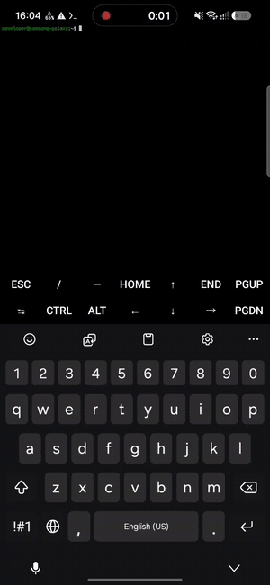
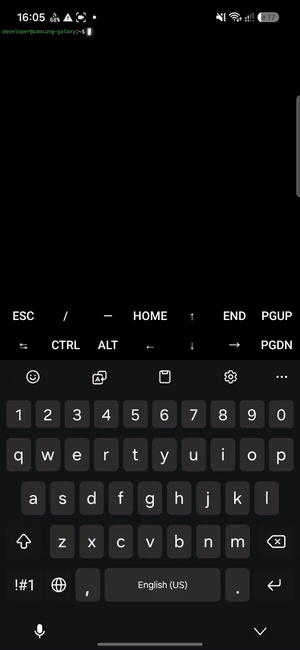
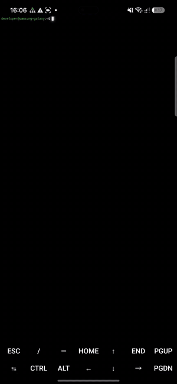
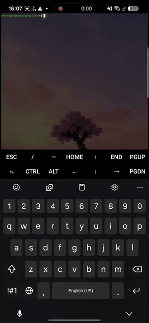

<div align="center">

# SmoothCursor

**Neovide-style smooth cursor, neon glow, fade-in text and custom wallpaper for Termux**

[🇬🇧 English](README.md) · [🇷🇺 Русский](README.ru.md)

[](https://github.com/AstrodiR2/SmoothCursor/releases/latest)
[](https://github.com/LSPosed/LSPosed)

</div>

SmoothCursor is an [LSPosed](https://github.com/LSPosed/LSPosed) module for [Termux](https://f-droid.org/packages/com.termux/). It hooks the terminal renderer and adds the visual polish you know from [Neovide](https://neovide.dev/), with a settings app to tune everything.

## Demo

| Smooth cursor | Cursor & text glow |
|:---:|:---:|
| [](docs/media/01-smooth-cursor.mp4) | [](docs/media/02-glow.mp4) |
| **Fade-in text** | **Custom wallpaper** |
| [](docs/media/03-fade-in.mp4) | [](docs/media/04-wallpaper.mp4) |

Click a GIF to open the full-quality video.

## Features

- **Smooth cursor** – the cursor glides between positions with an optional trail, like in Neovide
- **Neon glow** – text and cursor glow in the text's own color; size and brightness are adjustable
- **Fade-in text** – new characters (typing, `ls`, command output) appear smoothly; duration is adjustable and it can be turned off
- **Images in the terminal** – real images from `fastfetch`, `imgcat` and your own scripts (iTerm2 and kitty graphics protocols), with layers behind or in front of the text
- **Smooth scrolling** with adjustable speed
- **Terminal padding** – custom inner margins around the terminal
- **Wallpaper** – image, video or gradient behind the terminal text, with dimming
- **Startup splash** – optional intro with sound
- **Settings app** – every option can be toggled and tuned live, no Termux restart needed for most of them

## Images in the terminal

The module understands two graphics protocols, so programs can draw real images inside Termux:

- **iTerm2** (`OSC 1337;File=`) – `imgcat`, `fastfetch --logo-type iterm`
- **kitty** (`APC G`, subset) – `fastfetch --logo-type kitty-direct`, own scripts

Check `fastfetch --help` for the exact logo options of your version. Quick manual test:

```bash
# in front of the text
printf '\033]1337;File=inline=1;width=20:%s\a' "$(base64 -w0 image.png)"
# behind the text (z=-1 is an extension, other terminals ignore it)
printf '\033]1337;File=inline=1;width=20;z=-1:%s\a' "$(base64 -w0 image.png)"
# kitty protocol, behind the text
printf '\033_Ga=T,f=100,z=-1;%s\033\\' "$(base64 -w0 image.png)"
```

Images scroll with the text, disappear when the cells under them are erased (`clear`), and are kept per Termux session. The "Draw images behind text" switch in the settings app sets the default layer for programs that don't choose one. Layers: `z >= 0` is in front of the text, `z < 0` is behind it (cells with a non-default background still cover the image).

Supported kitty keys: `a=T|t|p|d|q`, `f=24|32|100`, `s`, `v`, `t=d|f|t`, `o=z`, `m`, `i`, `c`, `r`, `z`, `C`, `q`, `d=a|A|i|I`. Not supported: cropping (`x y w h`), pixel offsets, unicode placeholders, shared memory, animation, sixel. Inside `tmux`, images only pass with passthrough enabled.


## Requirements

- Rooted Android 7.0+ (API 24+) with [LSPosed](https://github.com/LSPosed/LSPosed)
- [Termux from F-Droid](https://f-droid.org/packages/com.termux/) (the Google Play build is deprecated)
- Glow needs Android 9+

## Installation

1. Download `SmoothCursor.apk` from the [latest release](https://github.com/AstrodiR2/SmoothCursor/releases/latest) and install it.
2. Open **LSPosed → Modules → SmoothCursor**, enable it and select **Termux** in the scope.
3. Force-stop Termux and start it again.
4. Open the **SmoothCursor** app to configure effects.

## Build from source

Every push to `main` builds an APK with GitHub Actions and publishes it in [Releases](https://github.com/AstrodiR2/SmoothCursor/releases). To build locally:

```bash
gradle assembleRelease
```

## Notes

- The module only touches the `com.termux` process.
- If an effect does not show up, check the LSPosed log for lines starting with `SmoothCursor`.

## Contributing

Issues and pull requests are welcome: [open an issue](https://github.com/AstrodiR2/SmoothCursor/issues).
