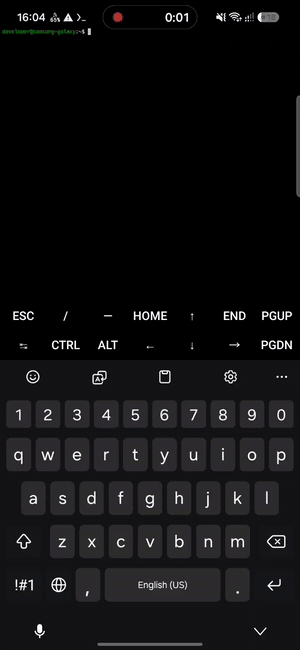
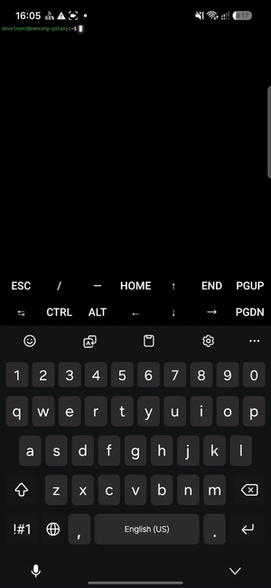
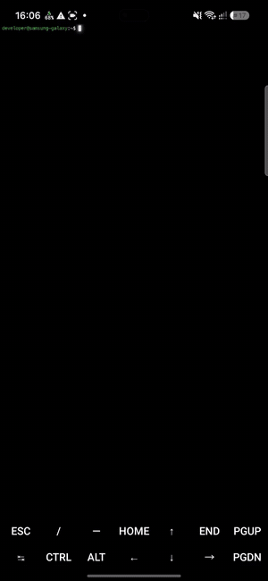
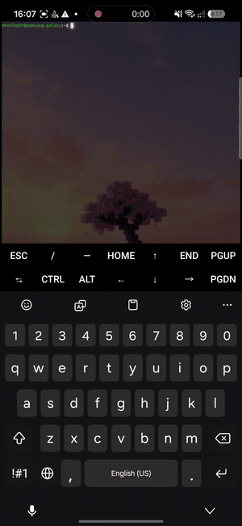

<div align="center">

# SmoothCursor

**Плавный курсор как в Neovide, неоновое свечение, плавное появление текста и свои обои для Termux**

[🇬🇧 English](README.md) · [🇷🇺 Русский](README.ru.md)

[](https://github.com/AstrodiR2/SmoothCursor/releases/latest)
[](https://github.com/LSPosed/LSPosed)

</div>

SmoothCursor это модуль [LSPosed](https://github.com/LSPosed/LSPosed) для [Termux](https://f-droid.org/packages/com.termux/). Он подключается к отрисовке терминала и добавляет эффекты, знакомые по [Neovide](https://neovide.dev/). Всё настраивается в отдельном приложении.

## Демо

| Плавный курсор | Свечение курсора и текста |
|:---:|:---:|
| [](docs/media/01-smooth-cursor.mp4) | [](docs/media/02-glow.mp4) |
| **Плавное появление текста** | **Свои обои** |
| [](docs/media/03-fade-in.mp4) | [](docs/media/04-wallpaper.mp4) |

Нажми на GIF, чтобы открыть видео в полном качестве.

## Возможности

- **Плавный курсор**: скользит между позициями, есть шлейф, как в Neovide
- **Неоновое свечение**: текст и курсор светятся цветом самого текста, размер и яркость настраиваются
- **Плавное появление текста**: новые символы (ввод, `ls`, вывод команд) проявляются плавно, длительность настраивается, можно выключить
- **Плавная прокрутка** с настраиваемой скоростью
- **Отступы** внутри окна терминала
- **Обои**: картинка, видео или градиент под текстом, с затемнением
- **Заставка при запуске**: по желанию, со звуком
- **Приложение настроек**: всё включается и настраивается на лету, для большинства опций перезапуск Termux не нужен

## Требования

- Android 7.0+ (API 24+) с root и [LSPosed](https://github.com/LSPosed/LSPosed)
- [Termux из F-Droid](https://f-droid.org/packages/com.termux/) (версия из Google Play устарела)
- Для свечения нужен Android 9+

## Установка

1. Скачай `SmoothCursor.apk` из [последнего релиза](https://github.com/AstrodiR2/SmoothCursor/releases/latest) и установи.
2. Открой **LSPosed → Модули → SmoothCursor**, включи модуль и выбери **Termux** в области действия.
3. Останови Termux принудительно и запусти заново.
4. Открой приложение **SmoothCursor** и настрой эффекты.

## Сборка из исходников

Каждый пуш в `main` собирает APK через GitHub Actions и выкладывает его в [Releases](https://github.com/AstrodiR2/SmoothCursor/releases). Локально:

```bash
gradle assembleRelease
```

## Заметки

- Модуль затрагивает только процесс `com.termux`.
- Если эффект не появился, посмотри лог LSPosed, строки начинаются с `SmoothCursor`.

## Участие в проекте

Issues и pull request'ы приветствуются: [создать issue](https://github.com/AstrodiR2/SmoothCursor/issues).
